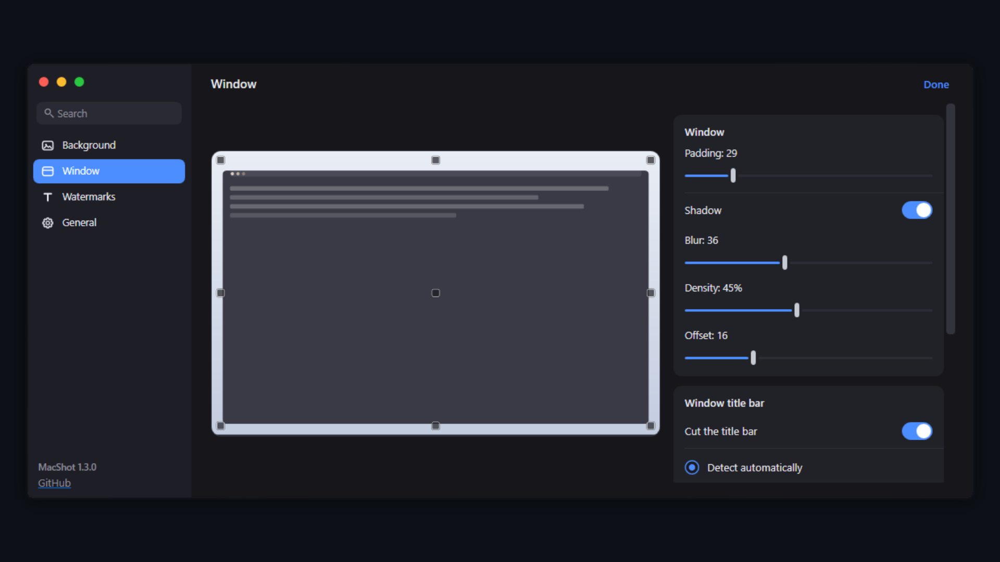

# MacShot

Window screenshots in the macOS style for Windows.

  



## Hide the title bar

Screenshots of other apps often carry a Windows title bar across the top, which breaks the illusion. Turn **Hide the window title bar** on and MacShot crops it away, leaving only the window content — with the top corners rounded to match the rest of the frame.

By default the height is **detected from the window geometry**: exactly the system caption is cut, and windows that have no system caption lose nothing. Modern apps — browsers, anything built on Electron — draw their own bar inside the client area, and those come through untouched.

Switch to **Set manually** if the app does draw its own bar on top and you want it gone. The preview on the left clips its mock with the same numbers the real render uses, so it cannot show something different from the actual screenshot.

### A height per application

One global number cannot suit everyone: one app may draw a tall bar of its own, the next has a standard caption, and the third has nothing at all. **Height per application** solves that.

An app is identified by the path to its `.exe`.

**The easiest way — let it add itself.** Turn on **Hide the window title bar**, take a screenshot of the app you care about, and a row appears for it carrying the height that was actually used. Drag the slider to change it, or remove the row to fall back to the global mode. A per-app value wins over both the automatic detection and the manual setting.

**Adding one in advance.** Press **Add application** and pick the `.exe`.

**If you do not know where it lives** — open Task Manager, find the process, right-click it and choose **Open file location**. That opens the folder with the executable selected; copy the path from the address bar, or drag the `.exe` onto the file picker.

Shortcuts are not accepted: a `.lnk` has its own path, which would never match the real window.

## Watermarks

Add a signature, a logo, or both — as many as you like. Everything is drawn onto the finished frame, so the result is a single flat PNG.

- **Any number of items.** Texts and pictures live in one list; add and remove them as needed.
- **Position on the preview itself.** Nine squares sit on the frame — click one to move the selected item there, or just drag the item. Occupied squares disappear so they never lie on top of your content.
- **They step aside for each other.** If a text and a picture are both at bottom center, they line up side by side instead of covering one another.
- **Text:** font, size, weight, italics, color, opacity, margin from the edge, and a shadow with its own color, blur and opacity.
- **Picture:** height (width follows the proportions), opacity, margin from the edge.

## Settings

| Option | Default |
|---|---|
| Appearance | dark, light available |
| Background | two-color gradient at an angle |
| Padding | 40 |
| Shadow | on: blur 36, offset down 16, density 0.45 |
| Background color | palette of 29 swatches plus the system color dialog |
| Watermark | off |
| Hide the window title bar | off, height detected per window, overridable per app |
| Hotkey | `Ctrl+Shift+8` |
| Language | English or Russian |
| Save a copy to Pictures | off |
| Start when I sign in to Windows | off |

The settings window shows a live preview on the left and the controls on the right, so every change is visible before you take a screenshot. The preview uses the same rendering code as the real capture — it cannot show you something different from what you get.

**Appearance** switches the interface between dark and light. The change is instant — the window is not reopened, and the choice is remembered.

Worth knowing:

- **The shadow adapts on its own.** On a dark background it turns light, on a light one it turns dark. Otherwise the window either sticks to the backdrop or disappears into it.
- **Corner radius is not configurable** — it is fixed, like on macOS.
- **Padding is exactly what you set.** At small values the shadow gets cut off by the frame edge.
- **Watermark margins are measured from the frame edge**, not from the window. With a text in a corner the margin therefore decides whether the signature lands on the backdrop or on the window itself.

## Installation

Download from [Releases](https://github.com/wintence/MacShot/releases) and run it with a double click. Nothing to install.

| File | Size | Requires |
|---|---|---|
| `MacShot-full.exe` | 68.5 MB | nothing, .NET is inside |
| `MacShot-lite.exe` | 0.9 MB | [.NET 8 Desktop Runtime](https://dotnet.microsoft.com/download/dotnet/8.0) |

The full file is large almost entirely because of the bundled .NET — the program itself is about 800 KB. Details in [docs/HOW-IT-WORKS.md](docs/HOW-IT-WORKS.md).

## Usage

1. Press the hotkey — `Ctrl+Shift+8` by default.
2. The screen dims and the window under the cursor is highlighted.
3. Click the window you want — the screenshot goes to the clipboard.
4. `Esc` cancels.

Right-click the tray icon: **Capture window**, **Settings**, **Exit**.

## Where files live

| What | Path |
|---|---|
| Settings | `%AppData%\MacShot\settings.json` |
| Log | `%AppData%\MacShot\MacShot.log` |
| Screenshots | `%Pictures%\MacShot` |

## Building from source

```powershell
git clone https://github.com/wintence/MacShot.git
cd MacShot
dotnet build
dotnet run
```

Requires the .NET 8 SDK.

## License

MIT — see [LICENSE](LICENSE).
