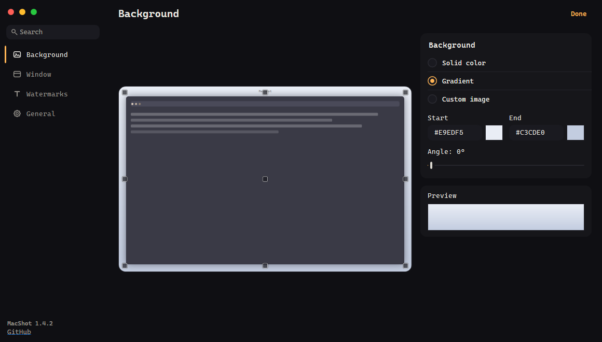

## What's new

- **The preview is the main item.** The frame sits on the left and takes all the
  free space — in the default window it is about half again as wide as before.
  Settings moved into a narrow inspector column on the right, and the frame now
  keeps its proportions at any window size: it fits both by width and by height,
  so a maximized window no longer pushes it off the bottom.
- **A quieter look.** No borders and no highlights doing the work of space:
  cards and fields float on a deep graphite page, and one warm amber accent
  marks the choice — the selected section gets an amber bar, the switches glow
  amber, and everything else stays neutral. The light theme follows the same
  idea on warm paper.
- Header of the page is larger, search and the source-link row sit quieter, and
  the window itself is wider by default (1160×660) to give the frame room.

## Two files — pick one

| File | Size | Requires |
|---|---|---|
| `MacShot-full.exe` | 68.5 MB | nothing, .NET is inside |
| `MacShot-lite.exe` | 0.9 MB | [.NET 8 Desktop Runtime](https://dotnet.microsoft.com/download/dotnet/8.0) |
